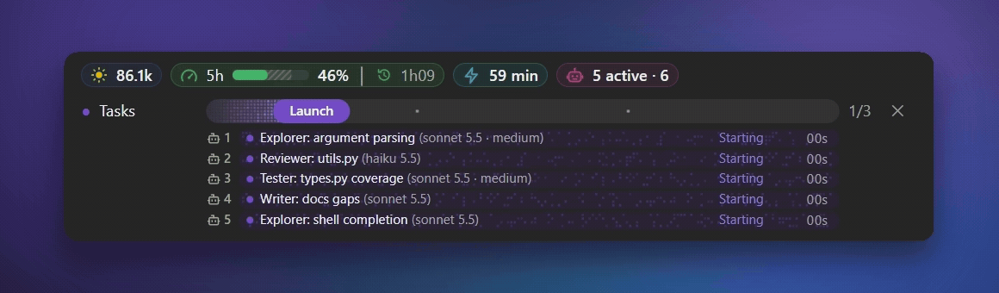
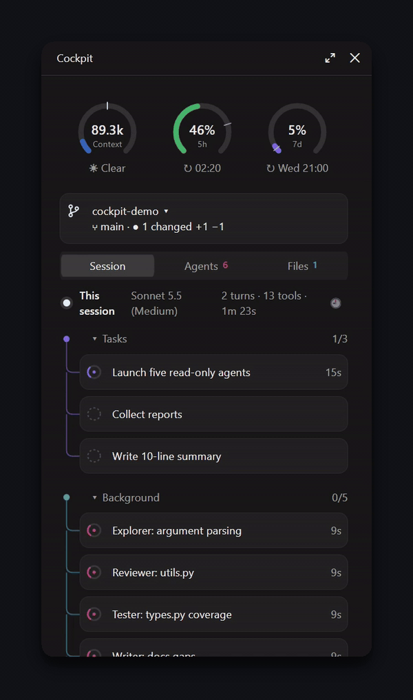

<div align="center">

# claude-mods

**cockpit** shows Claude Code users their session at a glance:<br>
context size, 5-hour limit, prompt cache and running agents, in one calm band above the prompt.

[](https://github.com/Atakan19/claude-mods/actions/workflows/ci.yml)
[](LICENSE)
[](https://docs.claude.com/en/docs/claude-code/plugins)

[Install](#install) · [What you get](#what-you-get) · [Options](plugins/cockpit#take-only-what-you-want) · [Contributing](CONTRIBUTING.md)



</div>

## Install

```bash
claude plugin install cockpit --marketplace Atakan19/claude-mods
```

<sub>In the desktop app: click **+** next to the prompt box → **Plugins** → **Add marketplace** with `Atakan19/claude-mods` → **Add plugin**.</sub>

Once installed, cockpit works on its own. Nothing needs to be called by hand; the pane opens with `/cockpit`.

## What you get

<table>
<tr>
<td valign="top">

**🎛️ Band** above the prompt<br>
Context, the 5h limit, the prompt cache and running agents at a glance, plus Claude's task list as a progress bar.

**📊 Pane** beside the chat<br>
Rings for context, 5h and 7d, your git branch, and tabs for the session tree, agents, changed files and history.

**🧾 Reply line** under each reply<br>
Duration, tool calls, context added, cache hit rate.

**🔔 Sounds and toasts**<br>
When Claude is done, needs you or fails.

**🧩 Every part switchable**<br>
Grey while all is well, yellow or red only when something needs attention. Keep only what you want.

</td>
<td align="center" width="340">



</td>
</tr>
</table>

## Take only what you want

Every part of cockpit has its own option. Set it at install with `--config name=value`, later in `/config`, or under `pluginConfigs.cockpit` in your Claude Code settings. Just the band, no pane:

```bash
claude plugin install cockpit --marketplace Atakan19/claude-mods --config pane=false
```

The full option table is in the [cockpit README](plugins/cockpit#take-only-what-you-want).

## Compatibility

Developed and tested against Claude Code **2.1.314**, in the terminal and the desktop app. cockpit uses Claude Code's plugin and mod API, so older versions may lack parts of it; put `claude --version` in any bug report.

<details>
<summary><b>Build your own mod</b></summary>

<br>

Every mod has the same shape, so you can copy one as a starting point:

```
.claude-plugin/marketplace.json   catalog read by /plugin marketplace add
plugins/<mod>/
  .claude-plugin/plugin.json      manifest and /config options
  hooks/register.tsx              wiring only
  hooks/*.ts(x)                   one file per part
  types/index.d.ts                $.state contract
  tests/*.test.tsx                claude plugin test
```

To work on a mod:

```bash
claude plugin validate plugins/cockpit
```

```bash
claude plugin test plugins/cockpit
```

```bash
claude --plugin-dir plugins/cockpit
```

</details>

## Contributing and license

Issues and pull requests are welcome, see [CONTRIBUTING.md](CONTRIBUTING.md). MIT, see [LICENSE](LICENSE). Code a mod takes from elsewhere keeps its own license, named in that mod's `NOTICE`.
